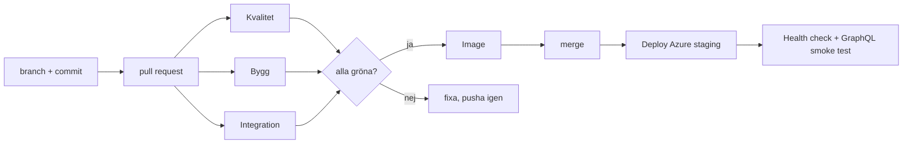

# CI-pipeline

## Flöde

## Vad stegen fångar

- **Lint:** hittar kodfel och problem med kodregler, till exempel oanvända variabler.
- **Format check:** kontrollerar att koden följer projektets Prettier-format.
- **Test:** kör Vitest och kontrollerar att testerna passerar.
- **Build:** kontrollerar att Vue-klienten kan byggas för produktion utan byggfel.
- **Integration:** startar riktiga PostgreSQL- och MongoDB-tjänster, seedar databaserna, migrerar turloggarna och kör API-testerna mot båda databaserna.

## Integration

Integration-jobbet körs både för pull requests mot `main` och för pushes till `main`. GitHub Actions startar följande tjänster:

| Tjänst     | Image         | Port på runner |
| ---------- | ------------- | -------------: |
| PostgreSQL | `postgres:16` |         `5432` |
| MongoDB    | `mongo:8.2`   |        `27017` |

Jobbet väntar på att båda tjänsternas health checks är gröna. Det använder testdatabaserna `utpost` med användaren `utpost` och kör sedan:

1. `npm ci`
2. `npm run seed`
3. `npm run migrate:logs`
4. `npm run test:api`

`migrate:logs` kopierar turerna och deras loggpunkter från PostgreSQL till MongoDB. Den är idempotent och verifierar att antalet turer och loggpunkter matchar PostgreSQL innan jobbet fortsätter.

`test:api` innehåller regressionstestet för N+1 (`begränsar antalet databasfrågor med DataLoader`). Det läser `extensions.databasfragor` och gör jobbet rött om turlistan kostar fler än 4 databasfrågor.

### Uppmätt tid för Integration

Tider från GitHub Actions 2026-10-27, jobbets totala tid:

| Körning | Integration | Länk |
| --- | ---: | --- |
| Pull request (`ci/integration-databases`) | 55 s | [körning 40554449564](https://github.com/1sa1asdev/Hasta-la-vue-lta/actions/runs/40554449564/job/122366623610) |
| Push till `main` (merge av #102) | 50 s | [körning 40557378215](https://github.com/1sa1asdev/Hasta-la-vue-lta/actions/runs/40557378215/job/122376943713) |

På samma körning på `main` var alla fyra jobben gröna: Kvalitet 36 s, Bygg 17 s, Integration 50 s och Image 60 s.

## Nödvändiga checks

Branch protection för `main` kräver att följande checks är gröna innan en pull request kan mergas:

- **Kvalitet**
- **Bygg**
- **Integration**
- **Image**

`Image` väntar på att Kvalitet, Bygg och Integration har lyckats. På pull requests byggs images utan att publiceras. På pushes till `main` publiceras de till GHCR.

## Uppmätta tider

Tider från en tidigare grön GitHub Actions-körning, innan Integration-jobbet fanns, där Bygg-jobbet tog totalt 25 s och Kvalitet-jobbet 19 s:

| Steg               |  Tid |
| ------------------ | ---: |
| npm ci (Kvalitet)  |  8 s |
| Lint               |  1 s |
| Format check       |  1 s |
| Test               |  2 s |
| npm ci (Bygg)      | 10 s |
| Build              |  2 s |
| Upload client dist |  2 s |
| Kvalitet totalt    | 19 s |
| Bygg totalt        | 25 s |

Det längsta enskilda steget var `npm ci` i Bygg-jobbet med 10 sekunder.

## Borttagning av den gamla React-klienten (M6 #3)

Den gamla React-klienten i `web/` är borttagen, så bara Vue-klienten i `client/` underhålls, testas och byggs.

### Vyer som flyttades till Vue

`web/` hade sju sidor. Fyra fanns redan i Vue (startsida, guider, turer, inloggning). Tre saknades eller var inte nåbara och portades före borttagningen:

| React-sida (`web/`)   | Vue-vy                                | Åtgärd                                                                 |
| --------------------- | ------------------------------------- | ---------------------------------------------------------------------- |
| `GuideDetail.jsx`     | `GuideDetailView.vue`, `/guider/:slug` | Ny vy. Guidens HTML saneras med DOMPurify (teknisk skuld 3).          |
| `TourDetail.jsx`      | `TourDetailView.vue`, `/turer/:id`    | Vyn fanns men saknade route. Länkar från startsidan och turlistan gick ingenstans. |
| `Profile.jsx`         | `ProfileView.vue`, `/profil`          | Ny vy som använder Pinia-storen. Utloggning går via routern.          |

### `npm ci` före och efter

Tiderna är steget "Install dependencies" (`npm ci`) i varje jobb.

- **Före:** senaste gröna körningen på `main` (`01fdcce`, 2026-10-27), [run 40572123823](https://github.com/1sa1asdev/Hasta-la-vue-lta/actions/runs/40572123823).
- **Efter:** senaste körningen på PR #114 (`e36ffcc`), [run 41317466955](https://github.com/1sa1asdev/Hasta-la-vue-lta/actions/runs/41317466955).

| Jobb        | Före | Efter |
| ----------- | ---: | ----: |
| Kvalitet    |  9 s |   9 s |
| Bygg        | 10 s |   5 s |
| Integration |  4 s |   7 s |

Den första körningen på PR:en ([run 41315344670](https://github.com/1sa1asdev/Hasta-la-vue-lta/actions/runs/41315344670), `ad2b0bf`) tog 45 s, 32 s och 28 s. Det var troligen en kall npm-cache efter ändringen i `package-lock.json` (inte verifierat i loggarna), så den används inte som "efter"-värde. Att ta bort `web/` gav ingen mätbar skillnad i `npm ci`-tid på CI.

Lokalt tog `npm ci` 6 s efter borttagningen (823 paket). Det är inte jämförbart med CI-tiderna och används inte som "efter"-värde.

## Docker images och publicering

Image-jobbet körs efter att Kvalitet, Bygg och Integration har lyckats. Det bygger Docker-images för API:t (`api/Dockerfile`) och klienten (`client/Dockerfile`).

- **Pull request:** Båda images byggs för att verifiera att Docker-byggena fungerar. De publiceras inte till GitHub Container Registry (GHCR).
- **Push till `main`:** Båda images publiceras till GHCR.
- **Taggar:** Images taggas med `sha-` följt av en kort commit-SHA, till exempel `sha-a1b2c3d`.
- **Behörigheter:** Endast Image-jobbet får `packages: write`, vilket begränsar publiceringsbehörigheten till det jobb som behöver den.

Images publiceras som:

- `ghcr.io/1sa1asdev/hasta-la-vue-lta-api`
- `ghcr.io/1sa1asdev/hasta-la-vue-lta-client`

## Deploy till Azure staging

Deploy-jobbet är det sista jobbet i GitHub Actions-pipelinen.

### När körs jobbet?

- **Pull request:** Deploy hoppas över. Ingen Azure-deployment görs.
- **Push till `main`:** Deploy körs efter att Kvalitet, Bygg, Integration och Image har lyckats.

Jobbet använder GitHub Environment `azure-staging`.

### Beroenden

Deploy väntar på att följande jobb ska lyckas:

- Kvalitet
- Bygg
- Integration
- Image

### Autentisering och säkerhet

GitHub Actions autentiserar mot Azure med OpenID Connect (OIDC).

Azure-identitetsinformationen konfigureras som variabler i GitHub Environment `azure-staging`:

- `AZURE_CLIENT_ID`
- `AZURE_TENANT_ID`
- `AZURE_SUBSCRIPTION_ID`

Workflow-jobbet använder `id-token: write` för att hämta en OIDC-token.

Inga Azure-credentials eller hemliga värden ska lagras direkt i workflow-filen eller som GitHub Secrets.

### Deployment

Deploy-jobbet ska använda API- och klientimages som byggts och publicerats av Image-jobbet för samma commit.

Images identifieras med commitens SHA-tag, så att den version som testats också är den version som distribueras.

Efter deployment ska jobbet:

1. Vänta tills `/api/health` svarar och bekräftar rätt commit-SHA.
2. Göra ett GraphQL-smoketest via klienten.
3. Kontrollera att GraphQL returnerar databasdata.

### Deploymentresultat

Följande information dokumenteras när deploymenten har verifierats:

- GitHub Actions-körning för en pull request där Deploy hoppas över.
- GitHub Actions-körning efter merge till `main`.
- Deploy-jobbets totala körtid.
- Bekräftad commit-SHA.
- Azure Container App revision name.
- Resultat från health check och GraphQL-smoketest.

**Status:** Deploymentresultat inväntar verifiering av Azure staging-deploymenten.