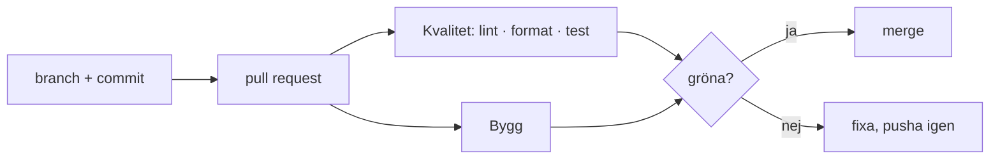

# CI-pipeline

## Flöde

## Vad stegen fångar

- **Lint:** hittar kodfel och problem med kodregler, till exempel oanvända variabler.
- **Format check:** kontrollerar att koden följer projektets Prettier-format.
- **Test:** kör Vitest och kontrollerar att testerna passerar.
- **Build:** kontrollerar att Vue-klienten kan byggas för produktion utan byggfel.

## Uppmätta tider

Tider från den gröna GitHub Actions-körningen där Bygg-jobbet tog totalt 25 s och Kvalitet-jobbet 19 s:

| Steg | Tid |
| --- | ---: |
| npm ci (Kvalitet) | 8 s |
| Lint | 1 s |
| Format check | 1 s |
| Test | 2 s |
| npm ci (Bygg) | 10 s |
| Build | 2 s |
| Upload client dist | 2 s |
| Kvalitet totalt | 19 s |
| Bygg totalt | 25 s |

Det längsta enskilda steget var `npm ci` i Bygg-jobbet med 10 sekunder.

## Docker images och publicering

Image-jobbet körs efter att både Kvalitet- och Bygg-jobben har lyckats. Det bygger Docker-images för API:t (`api/Dockerfile`) och klienten (`client/Dockerfile`).

- **Pull request:** Båda images byggs för att verifiera att Docker-byggena fungerar. De publiceras inte till GitHub Container Registry (GHCR).
- **Push till `main`:** Båda images publiceras till GHCR.
- **Taggar:** Images taggas med `sha-` följt av en kort commit-SHA, till exempel `sha-a1b2c3d`.
- **Behörigheter:** Endast Image-jobbet får `packages: write`, vilket begränsar publiceringsbehörigheten till det jobb som behöver den.

Images publiceras som:

- `ghcr.io/1sa1asdev/hasta-la-vue-lta-api`
- `ghcr.io/1sa1asdev/hasta-la-vue-lta-client`
